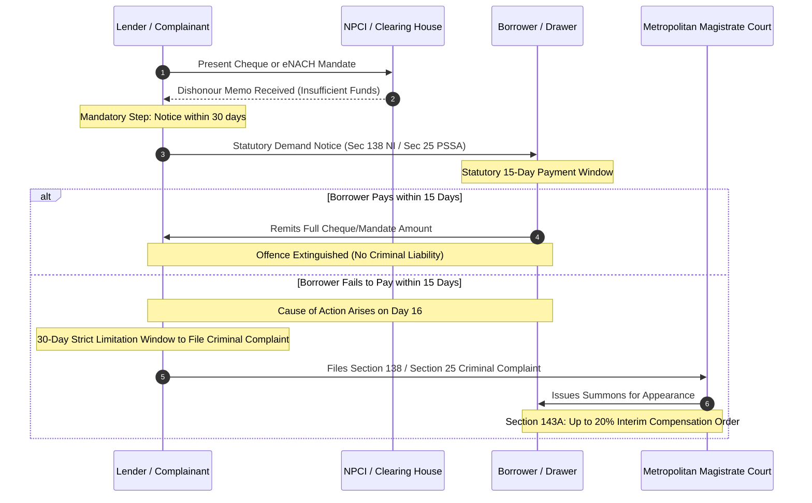

## Executive Overview {#overview}

When a borrower experiences a liquidity shortfall in India, monthly automated loan deductions or security cheques frequently dishonour due to **insufficient funds**.

A widespread misconception exists among borrowers that electronic automated debits (such as **eNACH**, National Automated Clearing House, or ECS mandates) are mere technological glitches that carry no legal liability.

In reality, Indian law establishes parallel criminal frameworks:
1. **Physical Paper Cheques:** Governed by **Section 138 of the Negotiable Instruments Act, 1881 (NI Act)**.
2. **Electronic Debit Mandates (eNACH / ECS / UPI SI):** Governed by **Section 25 of the Payment and Settlement Systems Act, 2007 (PSSA)**.

Both statutory provisions prescribe quasi-criminal penalties: **imprisonment for up to 2 years, or a monetary fine up to twice the dishonoured amount, or both**. However, establishing criminal liability requires meticulous adherence to statutory notice timelines.

---

## Statutory Framework & Timeline Comparison {#statutory-framework}

| Parameter | Section 138 NI Act (Cheques) | Section 25 PSS Act (Electronic Mandates) |
| :--- | :--- | :--- |
| **Instrument Type** | Physical paper cheque drawn on bank account | Electronic funds transfer / eNACH / ECS debit |
| **Grounds for Offence** | Insufficient funds or exceeds arrangement | Insufficient balance or exceeds credit limit |
| **Presentation Window** | Within 3 months from date of issue | Mandate presented as per agreed cycle |
| **Statutory Notice Timeline** | Within **30 days** of receiving bank bounce memo | Within **30 days** of receiving bank dishonour memo |
| **Mandatory Payment Window** | Drawer has **15 days** from notice receipt to pay | Sender has **15 days** from notice receipt to pay |
| **Cause of Action Date** | Arises on the **16th day** after notice delivery | Arises on the **16th day** after notice delivery |
| **Complaint Filing Limitation** | Within **30 days** (1 month) of cause of action | Within **30 days** (1 month) of cause of action |
| **Statutory Maximum Penalty** | Up to 2 years imprisonment, or 2x fine, or both | Up to 2 years imprisonment, or 2x fine, or both |

---

## Worked Practical Legal Timeline Case {#worked-analysis}

Consider a borrower whose personal loan auto-debit fails:

### Mathematical Calculation of Statutory Interim Compensation under Section 143A NI Act

Introduced via the Negotiable Instruments (Amendment) Act, 2018, Section 143A empowers the trial court to direct the drawer to deposit interim compensation pending trial:

$$InterimDeposit_{Max} = 0.20 \times ChequeAmount$$

If the trial concludes in an acquittal, the complainant is statutorily mandated to repay the interim compensation along with bank interest at the prevailing RBI repo rate + 2%:

$$RefundAmount = InterimDeposit \times \left(1 + \frac{RepoRate + 0.02}{365} \times t_{trial\_days}\right)$$

### Critical Legal Principles

1. **Premature Filing Invalidation:** If the lender files a criminal complaint before the expiry of the 15-day payment window, the complaint is legally void and subject to immediate dismissal.
2. **Limitation Expiry:** If the lender sends the demand notice on day 35 (exceeding 30 days from bounce intimation) or files the Magistrate complaint on day 75, the criminal action is barred by limitation under Section 142 of the NI Act / Section 25(5) of the PSSA.
3. **Legally Enforceable Debt Requirement:** The dishonoured instrument must have been issued for the discharge of a legally enforceable debt. If an instrument was obtained through fraud or represents arbitrary penal charges not supported by contract, valid legal defenses exist.

---

## Actionable Borrower Checklist {#actionable-checklist}

- [ ] **Track Delivery Date of Demand Notice:** Retain the postal envelope and speed post tracking receipt showing the exact date you received the notice; your 15-day defense clock starts on receipt.
- [ ] **Remit Principal Within 15 Days if Possible:** If funds can be arranged, paying the exact face value of the bounced cheque/mandate within the 15-day window completely extinguishes criminal cause of action.
- [ ] **Issue Written Reply to Notice:** If the claim contains inflated or illegal charges, engage legal counsel to send a formal reply within 15 days denying the claim and disputing the calculation.
- [ ] **Verify Stop-Payment Instructions:** Stopping payment on a cheque without reasonable cause is treated as dishonour under Supreme Court precedent; always communicate contractual disputes prior to presentation.
- [ ] **Compound the Offence:** Offences under Section 138 NI Act are legally compoundable under Section 147; parties can settle the dispute at any stage before or during trial.

---

## Common Pitfalls & Non-Compliances {#common-pitfalls}

1. **Refusing to Accept Registered Notices:** Under Indian evidentiary law, unclaimed or returned postal notices with "refused" endorsements are legally presumed to have been served on the drawer.
2. **Confusing Civil Arbitration with Criminal Court:** A criminal notice under Section 138 / Section 25 cannot be stayed merely by initiating private arbitration.
3. **Assuming Small Amounts Prevent Action:** Financial institutions frequently run automated bulk filing for amounts as low as ₹10,000; never ignore formal Magistrate summons.
