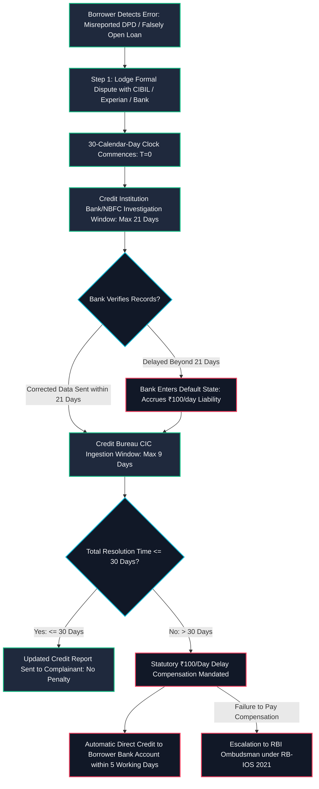

## Executive Overview {#overview}

Credit reports issued by India's four authorized Credit Information Companies (CICs)—**TransUnion CIBIL, Experian, Equifax, and CRIF High Mark**—directly dictate access to personal loans, home loans, credit cards, and employment security clearances.

Historically, Indian consumers faced systemic inertia when attempting to rectify erroneous entries: loans falsely reported as open despite full repayment, misreported Days Past Due (DPD), clerical identity mix-ups, or unrecorded No Objection Certificates (NOCs).

To enforce accountability, the **Reserve Bank of India (RBI)** issued comprehensive directions via circular **RBI/2023-24/72 (DoR.FIN.REC.48/20.16.003/2023-24)** on October 26, 2023 (effective April 26, 2024), establishing a binding **30-day resolution framework backed by statutory compensation of ₹100 per calendar day of delay**.

---

## Statutory Framework {#statutory-framework}

Under the **Credit Information Companies (Regulation) Act, 2005 (CICRA)** and circular **RBI/2023-24/72**:

### Mathematical Formulation of Bureau Delay Compensation under RBI/2023-24/72

Let $T_{elapsed}$ be the total calendar days from the timestamp of dispute registration until the delivery of the corrected credit file to the consumer:

$$DelayDays = \max(0, \; T_{elapsed} - 30)$$

The aggregate statutory compensation payable directly to the borrower is:

$$Compensation = DelayDays \times ₹100$$

When the delay spans both the Credit Institution ($CI$) and the Credit Information Company ($CIC$), the liability apportionment is governed by:

$$Liability_{CI} = \max(0, \; Days_{CI} - 21) \times ₹100$$
$$Liability_{CIC} = \max(0, \; Days_{CIC} - 9) \times ₹100$$

Where $Liability_{Total} = Liability_{CI} + Liability_{CIC}$.

### 1. The Strict 30-Calendar-Day Resolution Window
Every formal dispute or rectification request raised by a customer regarding erroneous credit information must be conclusively resolved within **30 calendar days** from the date the dispute is lodged with either the Credit Institution (CI - bank/NBFC) or the Credit Information Company (CIC - bureau).

### 2. The Internal 21-Day + 9-Day Responsibility Split
The 30-day window is divided between the participants:
- **Credit Institutions (Lenders):** Given up to **21 calendar days** to investigate the borrower’s query, verify internal ledger records, and submit corrected data to the bureau.
- **Credit Information Companies (Bureaus):** Given the remaining **9 calendar days** to ingest the corrected dataset, update the central consumer credit file, and deliver the revised credit information report (CIR) to the customer.

### 3. Statutory Compensation: ₹100 Per Calendar Day
If the dispute remains unresolved past **30 calendar days**, the defaulting institution is legally mandated to pay the customer **₹100 for each calendar day of delay**, starting from the 31st day until the date of conclusive resolution.

### 4. Direct Bank Account Crediting Within 5 Working Days
Once the dispute is resolved after delay, the liable entity (bank or bureau) must automatically credit the accumulated compensation into the borrower's bank account within **5 working days**.

---

## Worked Practical Compensation Case {#worked-analysis}

Consider a borrower whose home loan closure was delayed in reporting:

| Parameter | Value | Regulatory Basis |
| :--- | :--- | :--- |
| **Date Dispute Lodged with CIBIL** | 01 May 2026 | Day 0 |
| **Statutory 30-Day Window Expiry** | 31 May 2026 | Day 30 (Cutoff) |
| **Bank Submits Corrected Data** | 15 June 2026 | Day 45 (24 days late by bank) |
| **Bureau Updates Consumer File** | 20 June 2026 | Day 50 (Total resolution date) |
| **Total Calendar Days Elapsed** | 50 Days | 20 days past statutory limit |
| **Delayed Days Eligible for Compensation** | **20 Days** | 50 days - 30 statutory days |
| **Daily Compensation Rate** | ₹100 / day | Circular RBI/2023-24/72 Clause 4 |
| **Total Statutory Compensation Due** | **₹2,000** | 20 days × ₹100 |

In this scenario, because the bank exceeded its allocated 21-day window by 24 days, the bank is legally responsible for bearing the ₹2,000 compensation liability. The amount must be credited directly to the borrower's designated bank account within 5 working days of June 20, 2026.

---

## Actionable Borrower Checklist {#actionable-checklist}

- [ ] **Download Free Official Annual Report:** Exercise your statutory right to one free full credit report per calendar year from each of the 4 credit bureaus (CIBIL, Experian, Equifax, CRIF).
- [ ] **Gather Clear Documentary Proof:** Locate the original bank-issued No Objection Certificate (NOC), statement of account showing zero balance, or clearance letter.
- [ ] **File Formal Dispute Online:** Lodge the dispute via CIBIL’s dispute portal or through the lending bank’s grievance email, noting the exact Dispute ID.
- [ ] **Provide Bank Account / UPI Details Upfront:** Include your IFSC and Savings Account Number in the dispute description to ensure seamless payment of delay compensation.
- [ ] **Track Calendar Days from Day 1:** If day 31 arrives without a resolution confirmation, transmit a formal demand letter citing **RBI/2023-24/72** to the bank's Principal Nodal Officer.

---

## Common Pitfalls & Non-Compliances {#common-pitfalls}

1. **Disputing Subjective Credit Scores:** The ₹100/day compensation applies strictly to objective factual data errors (wrong overdue amount, unrecorded closure, fraudulent account). It does not apply to proprietary scoring algorithms or risk models.
2. **Accepting Verbal Assurances from Branch Managers:** Never rely on branch staff saying "it will reflect next month"; always maintain formal ticket numbers with date stamps.
3. **Failing to Escalate to RBI Ombudsman:** If the bank refuses to credit the ₹100/day statutory compensation post-resolution, lodge an immediate complaint on cms.rbi.org.in; the Ombudsman routinely enforces the circular strictly.
