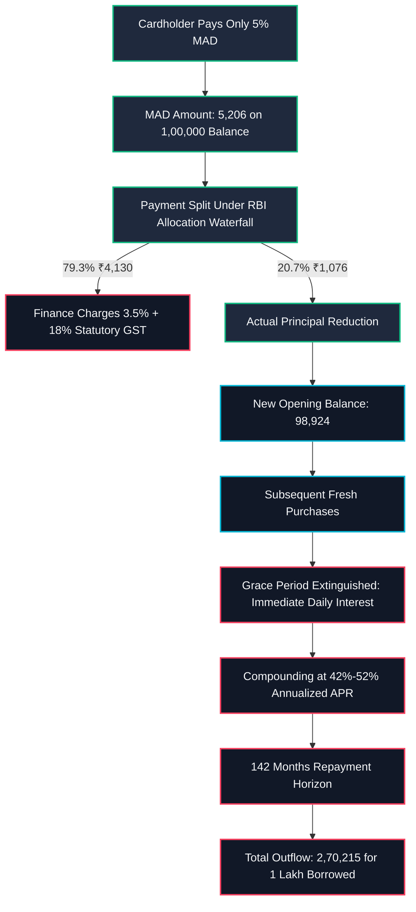

## Executive Overview {#overview}

Credit cards represent the most expensive unsecured consumer debt legally originated in India. While standard prime personal loans from commercial banks typically carry Annual Percentage Rates (APRs) between 10.5% and 16.0%, Indian private and public sector banks routinely charge revolving finance rates between 3.49% and 3.75% per month—translating to annualized rates of **41.88% to 52.86% APR**.

Moreover, cardholders who pay only the **Minimum Amount Due (MAD)** are frequently unaware of the structural mechanics governing interest accrual under the **RBI (Credit Card and Debit Card – Issuance and Conduct) Directions, 2022**:

1. **Instant Extinction of Interest-Free Grace Period:** The 20-to-50-day interest-free window is completely extinguished upon any partial settlement.
2. **Retroactive Transaction-Date Interest Accrual:** Finance charges accrue from the specific date of transaction, not the statement date or the payment due date.
3. **18% Statutory GST Drag:** All monthly finance charges, late fees, cash withdrawal fees, and renewal charges incur mandatory 18% GST under the Central Goods and Services Tax Act, 2017.
4. **Capitalization of Taxes and Fees:** Unpaid finance charges and GST are added directly to the principal balance, subjecting statutory taxes to future interest compounding.

This in-depth analysis provides a comprehensive mathematical, legal, and operational breakdown of the revolving credit card trap in India.

---

## Statutory Framework: RBI Credit Card Directions 2022 {#statutory-framework}

Under the **Reserve Bank of India (Credit Card and Debit Card – Issuance and Conduct) Directions, 2022 (Master Direction DOR.FSD.REC.27/24.01.041/2022-23)**, card issuers are bound by strict conduct and disclosure requirements:

### 1. Clause 9(a): Billing Cycle Transparency & Flexibility
Card issuers must provide cardholders with the option to modify or change the starting and closing dates of their monthly billing cycle **at least once**. This statutory right allows borrowers to align payment due dates with their monthly salary cycles to prevent inadvertent defaults.

### 2. Clause 9(b): Mandatory Minimum Amount Due (MAD) Warning Legend
All monthly billing statements (physical and electronic) must prominently display the following statutory warning legend on the first page:
> *“Making only the minimum payment every month would result in the repayment stretching over months/years with consequential compounded interest payment on your outstanding balance.”*

Furthermore, the statement must illustrate the exact number of months and total rupee interest required to pay off the current balance if only the Minimum Amount Due is paid each month.

### 3. Clause 10(b): The 3-Day Grace Period for Late Payment Reporting
To protect consumers from technical banking clearing delays, the RBI mandates that card issuers can only report an account as "past due" to Credit Information Companies (CICs like TransUnion CIBIL) or levy late payment charges if the payment remains unpaid for **more than 3 calendar days past the payment due date**.
- If a bill is due on the 10th of the month, late payment fees cannot be levied until the 14th.
- Late payment charges must be levied **only on the outstanding amount due after the due date**, and never on unbilled transactions or total credit limit.

### 4. Clause 9(c): Transparent Disclosure of Annualized Percentage Rate (APR)
Card issuers must clearly disclose the Annualized Percentage Rate (APR) along with the monthly rate in the Most Important Terms and Conditions (MITC) and in all billing statements. Quoting only the monthly rate (e.g., *"just 3.5%"*) without prominent display of the annualized rate (42.0% APR) is a regulatory violation.

---

## Worked Mathematical & Financial Analysis {#worked-analysis}

Consider an Indian cardholder who runs an outstanding statement balance of **₹1,00,000** at a typical bank APR of **42.0%** (3.5% monthly):



### Mathematical Formulation of Revolving Finance Charges & GST Drag

The daily finance charge ($DFC$) on an Indian credit card with annualized APR $r$ is:

$$DFC = Outstanding \times \left(\frac{r}{365}\right)$$

Under Section 9 of the CGST Act 2017, banking and financial charges attract an inelastic 18% tax:

$$TotalCharge_{daily} = DFC \times (1 + 0.18) = Outstanding \times \left(\frac{r}{365}\right) \times 1.18$$

The effective Annualized Percentage Rate including statutory GST ($APR_{effective}$) escalates:

$$APR_{effective} = r \times 1.18$$

For a standard 42.0% headline APR, the genuine cost of capital is:

$$APR_{effective} = 42.0\% \times 1.18 = 49.56\% \text{ per annum}$$

### Month-by-Month Amortisation Trajectory Paying Only MAD:

```
Month 1:
  Opening Principal:     ₹1,00,000.00
  Finance Charge (3.5%): ₹3,500.00
  18% GST on Interest:   ₹630.00
  Total Balance Billed:  ₹1,04,130.00
  Payment (5% MAD):      ₹5,206.50
  Allocation:
    - ₹4,130.00 (79.3%) goes to Interest and GST
    - ₹1,076.50 (20.7%) goes to Principal Reduction
  Closing Balance:       ₹98,923.50

Month 2:
  Opening Principal:     ₹98,923.50
  Finance Charge:        ₹3,462.32
  18% GST:               ₹623.22
  Total Balance Billed:  ₹1,03,009.04
  Payment (5% MAD):      ₹5,150.45
  Closing Balance:       ₹97,858.59

... Trajectory Continues Over 142 Consecutive Months (11.8 Years) ...
```

### Cumulative Summary of the MAD Trap (Assuming Zero New Spends):

```
--------------------------------------------------------------------------------
Metric                                   Value
--------------------------------------------------------------------------------
Original Principal                       ₹1,00,000.00
Total Months to Zero Balance             142 Months (11.8 Years)
Total Cumulative Interest Paid           ₹1,44,250.00
Total 18% GST Paid to Government         ₹25,965.00
Total Non-Principal Outflow              ₹1,70,215.00
TOTAL RUPEE OUTFLOW FOR ₹1 LAKH BORROWED ₹2,70,215.00 (2.7x Principal!)
--------------------------------------------------------------------------------
```

By paying only the minimum, the borrower pays **₹1.70 Lakhs in pure interest and government taxes** to service a ₹1.00 Lakh purchase.

---

## Negative Amortisation: The Danger of Underpaying

Prior to strict RBI formula enforcement, several card issuers allowed minimum payments that did not cover accrued finance charges. Today, negative amortisation occurs if a cardholder pays a arbitrary fixed amount below monthly charges:

```
Suppose a borrower with a ₹1,00,000 balance at 42% APR pays a fixed ₹3,500 per month:
Monthly Charges: Interest ₹3,500 + GST ₹630 = ₹4,130.
Payment Made:    ₹3,500.
Shortfall:       ₹4,130 - ₹3,500 = ₹630.
The unpaid ₹630 is added to the principal balance!
Closing Balance Month 1: ₹1,00,630.
Closing Balance Month 6: ₹1,03,980.
Closing Balance Month 12: ₹1,08,540.
```

Despite paying ₹42,000 over 12 months, the borrower owes **more than their starting balance**.

---

## The Retroactive Interest Trap on New Spends

The most destructive feature of revolving credit card debt is the complete loss of the **grace period**:

1. **Standard Grace Period:** On a fully cleared card, if you spend ₹10,000 on the 1st of the month, your bill generates on the 20th and is due on the 10th of next month. You enjoy up to 40 days of 0% interest.
2. **Revolving State:** If you leave even **₹1.00** unpaid on your bill, the entire grace period is revoked across the account.
3. If you buy groceries for ₹5,000 on the 2nd of the month, interest begins accruing at **0.115% per day from that exact second**.
4. By the time the bill arrives, you are charged 18 days of interest plus 18% GST on the groceries, converting everyday debit purchases into high-rate compounding loans.

---

## Actionable Borrower Checklist {#actionable-checklist}

- [ ] **Review Your Monthly Statement First Page:** Locate the statutory warning box detailing the exact payoff years and interest cost of paying only MAD.
- [ ] **Exercise Your One-Time Right to Change Billing Dates:** Align your statement due date to 5–7 days after your monthly salary credit date via your banking app.
- [ ] **Stop All Card Usage Immediately:** Freeze the physical card or lock it in your mobile banking app; never use a revolving card for daily utility or grocery purchases.
- [ ] **Inquire About In-App Balance EMI Conversion:** Major Indian issuers (HDFC, ICICI, SBI Cards) allow cardholders to convert revolving balances into a 12-month or 24-month EMI at 13%–15% reducing APR, instantly slashing your interest rate from 42% down to 14%.
- [ ] **Verify 3-Day Grace Buffer:** If facing a temporary salary delay, utilize the mandatory 3-day buffer before late payment charges or CIBIL delinquency flags can be legally levied.

---

## Common Pitfalls & Non-Compliances {#common-pitfalls}

1. **Believing MAD Extinguishes Debt:** MAD is calibrated to maximize bank profitability while keeping the loan performing under RBI classification.
2. **Taking Cash Advances from ATMs:** Using a credit card at an ATM incurs an upfront 2.5%–3.0% transaction fee + 18% GST, with finance charges accruing immediately on Day 1 without any grace period.
3. **Paying Only the Round Number:** If MAD is ₹4,512.40 and you pay ₹4,500, the remaining ₹12.40 can trigger late payment fees and loss of status.
4. **Ignoring Reward Point Expiration During Default:** While lenders may suspend reward point redemptions during delinquency, points cannot be retroactively cancelled without prior notification.
